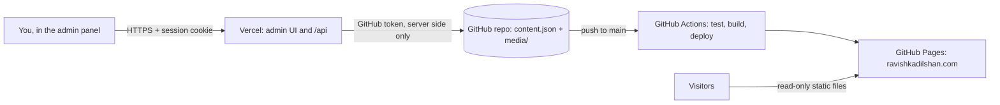

# ravishkadilshan.com

Official portfolio of Ravishka Dilshan, a cybersecurity student.

- **Live site:** https://ravishkadilshan.com (GitHub Pages)
- **Admin panel:** deployed separately on Vercel, behind a login (see [Admin panel](#admin-panel))

## How it fits together



The public site is plain static files. It has no API, no database and no secrets, and it never talks to the admin. Content lives in the repository as `content.json` and the `media/` folder. Publishing in the admin commits those files, and the pipeline redeploys the site.

## Security model

| Concern | How it is handled |
|---|---|
| Who can change content | Only a signed-in admin. Password is checked against a scrypt hash held in a Vercel environment variable. |
| Sessions | Signed (HMAC-SHA256) cookie named `__Host-rd_session`: `HttpOnly`, `Secure`, `SameSite=Strict`, 8-hour expiry. Not readable by page scripts. |
| Brute force | 800 ms delay on each failure and a lockout after 5 failures in 15 minutes per instance. Add a Vercel Firewall rate-limit rule on `/api/login` for a hard limit. |
| CSRF | `SameSite=Strict` cookie, an exact `Origin` check and a required `X-Requested-With` header on every write. No CORS headers are sent, so other sites cannot call the API. |
| GitHub access | A fine-grained token limited to this one repository (Contents: read and write). It lives only in Vercel environment variables and is never sent to the browser. |
| Input | Entries are validated on the server (field lengths, `http`/`https` links only, section names, media ids). Uploads are limited to 4 MB, allowed types only, and the file's content must match its extension. SVG is not allowed. |
| Rendering | The public site writes content with `textContent`, never `innerHTML`, so entries cannot inject markup. |
| Admin hardening | Strict Content-Security-Policy, HSTS, `X-Frame-Options: DENY`, `noindex`, and `Cache-Control: no-store` on API responses (see `vercel.json`). |

Because the repository is public, anything uploaded as media is public once it is committed, even for an unpublished draft. Do not attach private files.

## Repository layout

```
index.html, style.css, app.js, theme.js, published.js   public site
content.json                                            published content (edited by the admin)
media/                                                  uploaded images and documents
assets/                                                 fixed site assets
CNAME, .nojekyll                                        custom domain and Pages settings
admin/                                                  admin UI source (index.html, admin.js, admin.css)
api/                                                    admin API (Vercel serverless functions)
lib/                                                    shared server code (auth, GitHub client, validation)
scripts/                                                build, test and password-hash tools
test/                                                   admin API tests
.github/workflows/deploy.yml                            test, build and deploy pipeline
vercel.json                                             admin build settings and security headers
```

## Public site deployment

Every push to `main` runs `.github/workflows/deploy.yml`:

1. **Test:** syntax checks, file reference checks, `content.json` validation and the admin API tests (`node scripts/test.mjs`).
2. **Build:** `scripts/build.sh` assembles `dist/` with the public files only. The admin, API and scripts are not deployed to the public site.
3. **Deploy:** publishes `dist/` to GitHub Pages. Pull requests run steps 1 and 2 only.

Requirements: Settings → Pages → Source set to **GitHub Actions**, custom domain `ravishkadilshan.com`, Cloudflare DNS records set to the GitHub Pages addresses.

## Admin panel

The admin runs on Vercel at a subdomain such as `admin.ravishkadilshan.com`. Setup, once:

1. **Create the GitHub token.** GitHub → Settings → Developer settings → Fine-grained tokens → Generate new token. Under repository access choose only this repository, and set Permissions → Contents to **Read and write**.
2. **Create the password hash.** Run `node scripts/hash-password.mjs` and copy the `ADMIN_PASSWORD_HASH=...` line it prints. Use a long, unique password.
3. **Import the project in Vercel.** Add New → Project → pick this repository. Leave the Root Directory as the repository root and the framework as Other. `vercel.json` sets the build.
4. **Set environment variables** (Production):

   | Name | Value |
   |---|---|
   | `ADMIN_PASSWORD_HASH` | from step 2 |
   | `SESSION_SECRET` | a random string of 32 or more characters, for example from `openssl rand -hex 32` |
   | `GITHUB_TOKEN` | from step 1 |
   | `ADMIN_ORIGIN` | `https://admin.ravishkadilshan.com` (your exact admin URL, no trailing slash) |
   | `GITHUB_REPO` | optional, defaults to `DilshanAberathna/ravishkadilshan.com` |
   | `GITHUB_BRANCH` | optional, defaults to `main` |

5. **Add the domain.** In Vercel, Settings → Domains → add `admin.ravishkadilshan.com`. In Cloudflare DNS add a `CNAME` for `admin` pointing to `cname.vercel-dns.com`, set to **DNS only** (grey cloud).
6. **Redeploy** so the environment variables take effect, then open the admin URL and sign in.

Vercel skips rebuilding the admin when a commit only changes `content.json` or `media/` (see `ignoreCommand` in `vercel.json`).

### Using it

Pick a section, write or edit an entry, then **Save draft** (kept in your browser) or **Publish**. Publishing commits `content.json` to `main`, the pipeline runs, and the live site updates in about one to two minutes. Unpublishing removes the entry the same way. If you edit `content.json` by hand in GitHub, reload the admin before publishing.

Media: images, MP4/WebM, PDF, DOC/DOCX/ODT and TXT, up to 4 MB each (Vercel's request limit). Host larger videos elsewhere and link to them. On the Profile section, the first image becomes the hero portrait and the first document becomes the résumé link.

### Rotating secrets

- **Password:** run `node scripts/hash-password.mjs`, replace `ADMIN_PASSWORD_HASH` in Vercel, redeploy.
- **Sign out everywhere:** change `SESSION_SECRET` and redeploy.
- **GitHub token:** create a new one, replace `GITHUB_TOKEN`, redeploy, then delete the old token.

## Development

```bash
node scripts/test.mjs      # checks and admin API tests (Node 20 or newer)
./scripts/build.sh         # builds the public site into dist/
node scripts/build-admin.mjs   # builds the admin UI into admin-dist/
```

To preview the public site locally, run `./scripts/build.sh` and serve `dist/` with any static server, for example `python3 -m http.server -d dist 4173`.

## Moving content from the old local admin

The old local admin stored content in `.portfolio-published.json` and uploads in `.portfolio-media/`, next to the project folder. The format is the same as `content.json`. To keep that content, copy `.portfolio-published.json` over `content.json`, copy the files from `.portfolio-media/` into `media/`, then commit and push.
